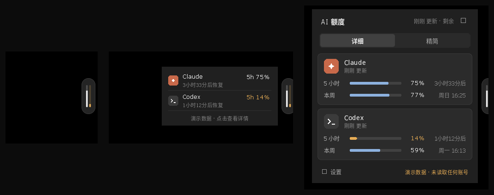
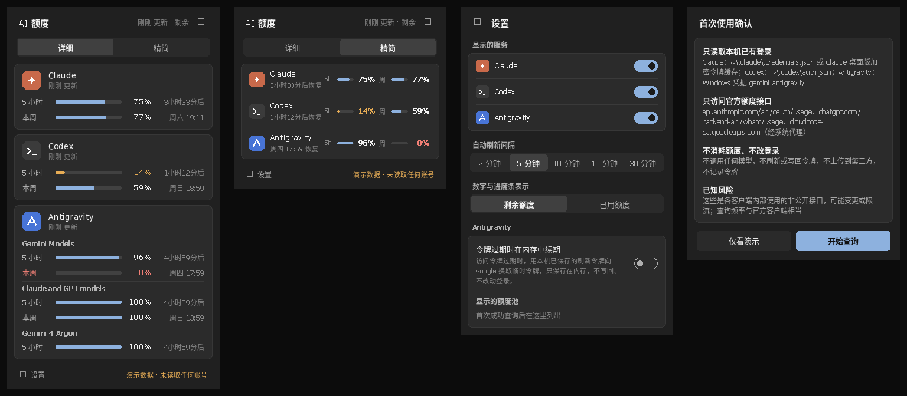

# AI Usage Lite

Windows 11 托盘额度监控：Claude、Codex、Antigravity 的 5 小时 / 每周剩余额度与恢复时间，以及 DeepSeek API 的人民币余额（可选）。单个便携 EXE（约 1 MB），以屏幕边缘悬浮条或托盘图标常驻，无需安装运行环境。

*A tiny Windows 11 tray app that shows your remaining Claude / Codex / Antigravity usage limits (5-hour and weekly) and when they reset, plus your DeepSeek API balance (optional). Read-only, no telemetry, never calls a model.*





下载：见本仓库 [Releases](../../releases) 页面的 `AI-Usage-Lite-v0.4.6-windows-x64.zip`。

> 非官方工具，与 Anthropic、OpenAI、Google、DeepSeek 无关联；Claude、Codex、Antigravity、DeepSeek 为各自所有者的商标。

## 一、启动

| 方式 | 作用 |
|---|---|
| 双击 `AI-Usage-Lite.exe` | 真实模式。首次启动弹出「首次使用确认」页，点「开始查询」后才会读取登录；点「仅看演示」则本次只显示示例数据 |
| 双击 `演示模式.cmd` | 示例数据，不读取任何文件、不联网 |
| 双击 `设置DeepSeek密钥.cmd` | 保存（或删除）DeepSeek API Key，见下方「DeepSeek 余额」 |
| 双击 `只读诊断.cmd` | 对各服务各做一次只读查询，生成不含令牌的报告（`%LOCALAPPDATA%\AI-Usage-Lite\diagnose-*.txt`），用于和官方页面核对 |
| 命令行 `AI-Usage-Lite.exe --diagnose --silent` | 同上，但不弹任何对话框，供脚本或 AI 调用。退出码 `0` 表示报告已保存，非 `0` 表示保存失败。`--silent` 只在同时带 `--diagnose` 时生效 |

成功标志：任务栏右下角出现三根竖条的图标（依次为 Claude 橙色、Codex 黑色／深色任务栏下白色、Antigravity 蓝色，高度 = 最紧张窗口的剩余比例；低于 10% 变红色，灰色空槽表示无数据或需要登录）。鼠标悬停可看文字摘要。

再次双击 EXE 不会启动第二份，只会打开已在运行的面板。**更新版本时**：直接双击新版 EXE 即可，它会自动让正在运行的旧版退出并接替（设置页底部显示当前版本号，可用来确认）。

## 二、操作

**屏幕边缘悬浮条**（默认）

- 平时只在屏幕右边缘露出一道半透明的淡橙色细条；有服务剩余额度低于 10% 时细条变成醒目的红色。
- 鼠标移到细条上：滑出胶囊，每根竖条代表一项服务的剩余额度，按品牌着色（Claude 橙色、Codex 黑色／深色主题下浅灰、Antigravity 采用 Google 蓝），低于 10% 变红。面板里的百分比数字为常规黑色，低于 10% 时与额度条一起变红。
- 单击胶囊：弹出迷你卡片，显示各服务最紧张窗口的剩余比例和恢复时间；点卡片上的服务图标直接打开对应客户端，点卡片其他位置或再单击胶囊：打开完整面板；再单击：收起。
- 按住拖动：可移到屏幕任意高度，松手自动吸附到最近的左／右边缘，位置会记住。右键胶囊：刷新 / 设置 / 退出。
- 有程序全屏（看视频、放幻灯片、游戏）时自动隐藏；悬浮条不抢键盘焦点。

**托盘图标**（始终保留）

- 左键单击：打开或收起完整面板；右键：刷新额度 / 设置 / 退出。

**消耗预估**（默认开启，可在设置中关闭）

- 速度 = 近期速度 × 70% + 本周期平均速度 × 30%：
  - 本周期平均速度：窗口开始时间 = 重置时间 − 窗口长度（5 小时 / 7 天等），平均速度 = 已用比例 ÷ 已过去的时间；
  - 近期速度：程序每次刷新记下一次读数，5 小时窗口看最近 1 小时、周额度看最近 24 小时的用量变化；
  - 程序刚启动、近期读数跨度不足（5 小时窗口不足 20 分钟、周额度不足 8 小时）时，只用平均速度；额度重置后自动清空读数重新累计。读数只存内存，不写磁盘、不额外请求。
- 详细视图每个窗口下用一行小字给出结论：“可撑到重置”，或“约 X 后用完”（均按本周期当前速度推算）。
- 迷你卡片和精简视图在撑不到重置时显示“约 X 后用完”，否则照常显示恢复时间。
- 窗口刚开始（不足窗口长度的 1/20 且少于 10 分钟）或尚未使用时不做预估；这是基于用量节奏的粗略推算，仅供参考。
- 详细视图右侧一列是各额度窗口的**重置时间**（不是“还能用多久”），卡片右上角有「重置时间」列标题。
- DeepSeek 余额见下方「DeepSeek 余额」中的「今日已用 / 约 N 天后用完」。

**DeepSeek 余额**（可选，默认不显示）

1. 在 DeepSeek 开放平台（platform.deepseek.com）的「API keys」页创建一个 API Key（建议单独建一个，名称如 AI-Usage-Lite，方便以后单独删除）。
2. 双击 `设置DeepSeek密钥.cmd`，粘贴 Key 后回车。成功标志：窗口显示「已保存」。Key 存进 Windows 凭据管理器（条目 `AI-Usage-Lite/DeepSeek`，按当前 Windows 用户加密），不写入配置文件。也可改用环境变量 `DEEPSEEK_API_KEY`。
3. 打开 AI Usage Lite →「设置」→ 开启 DeepSeek（首次启动时若已存在 Key 会自动开启）。
- 显示：详细视图、精简视图和迷你卡片都显示总余额；托盘悬停文字中也有一行。详细视图、悬浮条和托盘图标按 ¥100 = 满格画一根 DeepSeek 蓝横条 / 竖条（超过 ¥100 也是满格，排在最后）；四项服务都开启时，托盘图标的竖条会略微变细以便放下。
- 消耗统计与可用天数：DeepSeek 余额接口只返回当前余额，没有用量或账单记录，所以本程序按余额变化推算：
  - 每次刷新记一条“时间, 余额”到 `%LOCALAPPDATA%\AI-Usage-Lite\deepseek-history.json`（只有时间和金额，不含 Key；保留 30 天，3 天前的读数合并为每小时一条，文件只有几十 KB）；
  - 相邻两次读数之间余额下降的部分计为消耗；余额上升视为充值，不计负消耗（同一刷新间隔内既充值又消费时，这段消费会少算）；程序关闭期间的消耗会体现在下一次读数里；
  - 「今日已用」从本地时间 0 点算起，跨 0 点的读数间隔按时间比例分摊；
  - 日均消耗 = 近 3 天日均 × 70% + 近 14 天日均 × 30%，按自然时间计算（没用的日子也算在内）；可用天数 = 当前余额 ÷ 日均消耗；
  - 刚开始使用、读数不足 24 小时时，把已记录到的消耗当作一天的量（消耗 ÷ max(记录时长, 1 天)），先给出一个偏保守（偏长）的预估，随读数增加逐步收敛；读数不足 1 小时或近期没有消耗时不预估；超过 90 天显示「可用 3 个月以上」；
  - 本程序的只读诊断报告（`%LOCALAPPDATA%\AI-Usage-Lite\diagnose-*.txt`）里的 DeepSeek 余额也会作为历史读数并入，早于首次运行的数据不浪费。
  - 详细视图：与 Claude / Codex 同一版式——「余额」、横条、金额，右列标题为「今日已用」，下面一行显示「约 X天X小时后用完」；迷你卡片和精简视图显示「约 X天X小时后用完」；关闭「消耗预估」后只显示今日已用。不再单独显示充值 / 赠金明细（诊断报告里仍有）。
- 余额低于 ¥10 或 DeepSeek 返回「余额不足」时数字变红（阈值可在 `config.json` 的 `deepseek_low_balance` 修改）。
- 点 DeepSeek 图标打开 DeepSeek Harness（DSH）桌面客户端。图标为 DeepSeek 蓝底“DS”字样。
- 撤销：再次运行脚本直接回车即删除；或命令行执行 `cmdkey /delete:AI-Usage-Lite/DeepSeek`；也可到 DeepSeek 平台删除该 Key。

**长期消耗记录**（默认开启）

为以后按月、按年分析 AI 额度和费用，程序在每次成功刷新后，把**数值有变化**的读数追加到记录文件（程序启动后的第一次读取也各记一行作为起点）。程序本身不做任何统计，追加一行只有几百字节，几乎不占资源；分析时让任意 AI 工具或脚本读取这些文件即可。

- 位置：`config.json` 的 `usage_log_dir`；不填则为 `%LOCALAPPDATA%\AI-Usage-Lite\usage-log`。可以设到网盘同步目录作长期备份（记录里没有任何凭据）。
- 文件：`usage-YYYY-MM-<计算机名>.jsonl`，每月、每台电脑一个文件，多台电脑同步同一文件夹也不会互相覆盖；永不自动删除，一年约几 MB。
- 每行一个 JSON：
  - 首行 `{"type":"meta", "version", "device", "subscriptions", "usd_to_cny", "note"}`：程序版本、计算机名、设置里的订阅月费和汇率；
  - 额度：`{"t":"2026-11-08T09:05:30+08:00", "service":"Claude", "window":"5 小时", "used_pct":4.0, "resets_at":"…"}`（Antigravity 另有 `"pool"`）；
  - 余额：`{"t":"…", "service":"DeepSeek", "balance":86.4, "currency":"CNY", "available":true}`。
- 订阅月费与汇率：在 `config.json` 里填写，例如 `"subscriptions":[{"service":"Claude","plan":"Claude Pro","monthly_fee":20,"currency":"USD"}]`、`"usd_to_cny":7.1`；程序不联网取汇率，只把你填的值写进每月文件首行，供报告折算人民币。
- 关闭：`config.json` 中 `"usage_log": false`。

**完整面板**

- 点服务图标直接打开对应客户端：Claude → Claude 桌面版，Codex → ChatGPT 客户端，Antigravity → Antigravity，DeepSeek → DeepSeek Harness（DSH）。客户端按开始菜单里的名称查找，未安装时会提示。
- 自定义图标（可选）：把图片放进 `%APPDATA%\AI-Usage-Lite\icons\`，文件名为 `claude.png`、`codex.png`、`antigravity.png` 或 `deepseek.png`（PNG / ICO / JPG / BMP 均可，正方形效果最好），重启程序后即替换对应的内置图标；删除文件即恢复。本项目不附带任何官方标志。
- 顶部「详细 / 精简」切换视图；底部「设置」进入设置页；点面板外部或按 Esc 收起；F5 刷新。
- 内容超出屏幕高度时可上下滚动：鼠标滚轮、拖动右侧滚动条（Windows 11 样式，平时是一道细线，鼠标移近变粗、可拖动，静止约 1 秒后隐去），或键盘 PgUp / PgDn / Home / End / ↑↓。标题栏固定不动，底部渐隐表示下方还有内容。
- 设置项：显示方式（悬浮条 / 仅托盘）、消耗预估开关、显示哪些服务、自动刷新间隔（2/5/10/15/30 分钟，默认 5）、数字表示剩余还是已用、Antigravity 内存续期与额度池（关闭 Antigravity 后这一组自动隐藏，设置页更短）。设置页底部显示本程序当前内存占用。

## 三、状态含义

| 显示 | 含义 |
|---|---|
| 进度条 + 百分比 | 正常；默认显示**剩余**比例 |
| 百分比为 0%、窗口名变红 | 该窗口额度已耗尽，右侧是恢复时间 |
| 登录已过期 | 本机令牌过期。打开对应客户端用一下，它会自行续期，本程序随后自动恢复 |
| 登录失效 | 服务端拒绝令牌（401/403），需在客户端重新登录 |
| 未找到登录 | 本机没有该服务的登录 |
| 网络错误 / 请求受限 / 服务异常 | 暂时性问题，按 1→2→4… 分钟退避重试，受限时遵守服务端的 Retry-After |
| 暂不支持 | 接口对该账号不可只读查询，不会改用高风险方式 |
| 数据过期 | 超过 3 个刷新周期（至少 20 分钟）没有成功刷新，显示的是旧数据 |

有旧数据时出错，旧数据变灰保留，并注明是几点的数据；不会把异常显示成 0%。

## 四、读取范围与请求（安全说明）

只读取，不修改：

- Claude：`%USERPROFILE%\.claude\.credentials.json`；该令牌缺失、过期或被拒绝时，才读取 Claude 桌面版的加密令牌缓存（`%APPDATA%\Claude\config.json` 等，用当前 Windows 用户的 DPAPI 解密，仅在内存中使用）。
- Codex：`%USERPROFILE%\.codex\auth.json`。
- Antigravity：Windows 凭据管理器中的 `gemini:antigravity` 条目。
- DeepSeek（仅在你设置过 Key 时）：环境变量 `DEEPSEEK_API_KEY`，或 Windows 凭据管理器中的 `AI-Usage-Lite/DeepSeek` 条目。

只请求这些地址（经 Windows 系统代理，即 Clash Verge 的「系统代理」；也支持 HTTPS_PROXY 环境变量；不支持 PAC 自动配置脚本）：

- `GET https://api.anthropic.com/api/oauth/usage`
- `GET https://chatgpt.com/backend-api/wham/usage`
- `POST https://cloudcode-pa.googleapis.com/v1internal:loadCodeAssist`、`:retrieveUserQuotaSummary`，必要时 `:fetchAvailableModels`（先试 `daily-cloudcode-pa` 镜像）
- `GET https://api.deepseek.com/user/balance`（DeepSeek 官方公开的余额查询接口，只读、不计费）
- 仅当你在设置中开启「令牌过期时在内存中续期」：`POST https://oauth2.googleapis.com/token`（用本机已保存的刷新令牌换临时访问令牌，只存内存，不写回）。默认关闭。

不做的事：不调用任何模型；不刷新、不写回、不删除任何登录；不运行 claude / codex 命令；不修改注册表、代理、DNS、防火墙；没有统计和遥测；令牌不写日志、不写磁盘。

已从上游删除的三处耗额度机制：Claude 的 `/v1/messages` 探测（一次 1 token 的 Haiku 真实请求）、Claude 令牌过期时执行 `claude -p .`、Codex 令牌失效时执行 `codex exec .`。

已知风险：这些都是官方客户端内部使用的非公开接口，没有对外承诺，可能随时变更、限流；Claude 用量接口对频繁请求较敏感，建议刷新间隔不低于 5 分钟。Antigravity 请求使用 Antigravity CLI 的 User-Agent（与上游项目一致）。

Antigravity 额度池：每个池都按服务端实际返回的数据显示，不硬编码。名称含 Argon、Claude、GPT 的池在首次出现时默认隐藏（部分推广类订阅无法使用这些模型），可在设置中重新打开。

## 五、文件位置

- 程序：你放 EXE 的位置（建议放在普通本地目录，不要放进网盘同步目录）。
- 设置：`%APPDATA%\AI-Usage-Lite\config.json`（不含任何凭据）。
- 诊断报告：`%LOCALAPPDATA%\AI-Usage-Lite\`（只在运行诊断时生成）。
- DeepSeek 余额读数：`%LOCALAPPDATA%\AI-Usage-Lite\deepseek-history.json`（只在开启 DeepSeek 后生成，只有时间和金额；删除后消耗统计从头累计）。
- 长期消耗记录：`config.json` 中 `usage_log_dir` 指定的文件夹，默认 `%LOCALAPPDATA%\AI-Usage-Lite\usage-log`（见上文「长期消耗记录」）。

## 六、开机自启（可选，手动）

程序不会自己改注册表。需要自启时：按 Win+R 输入 `shell:startup` 回车，把 `AI-Usage-Lite.exe` 的快捷方式放进去。撤销：删除该快捷方式。

## 七、退出与完整卸载

1. 右键托盘图标 →「退出」（进程会完全结束，可在任务管理器确认没有 `AI-Usage-Lite.exe`）。
2. 删除程序文件夹。
3. 删除 `%APPDATA%\AI-Usage-Lite` 和 `%LOCALAPPDATA%\AI-Usage-Lite`（如存在）。
4. 如设置过 DeepSeek Key：执行 `cmdkey /delete:AI-Usage-Lite/DeepSeek`。
5. 如设置过开机自启，删除 `shell:startup` 里的快捷方式。

如把长期消耗记录设到了其他文件夹，按需保留或删除那里的 `usage-*.jsonl`（那是你的历史记录，卸载时不必删）。

除上述位置和凭据条目（由你运行脚本创建）外，本程序没有写入其他任何位置。

## 八、更新上游额度读取模块

额度接口逻辑来自 CodeZeno/Claude-Code-Usage-Monitor v2.23.0（MIT）。上游修复接口变化后：

1. 在上游仓库查看 `git diff v2.23.0..<新版本> -- src/poller/`。
2. 原样移植的三个文件可直接替换后做同样三处改动（导入路径改为 `crate::diag` / `crate::paths` / `super::compat`、删除末尾测试模块、`#[link(name = "Advapi32")]` 改小写）：
   - `src/poller/claude_desktop.rs` → `src/providers/claude_desktop.rs`
   - `src/poller/windows_credentials.rs` → `src/providers/wincred.rs`
   - `src/poller/claude/limits.rs` → `src/providers/claude_limits.rs`
3. 改写过的三个文件（`claude.rs`、`codex.rs`、`antigravity.rs`）只移植端点、请求头和字段解析的变化；**不要**带回 messages 探测、CLI 刷新等会消耗额度的逻辑。
4. 重新编译。

## 九、从源码编译

在 Windows 上：安装 Rust（rustup，选 `x86_64-pc-windows-gnu` 或装好 VS 生成工具后用默认 MSVC），在仓库根目录执行 `cargo build --release`，产物在 `target\release\ai-usage-lite.exe`。v0.4.5 起发布的 EXE 在 Windows 11 上用 Rust 1.99.1（`x86_64-pc-windows-msvc`）编译。

发布构建请先在 PowerShell 设置路径重映射，避免依赖源码的本机路径（含 Windows 用户名）写进 EXE：

```powershell
$env:RUSTFLAGS = "--remap-path-prefix=$env:USERPROFILE\.cargo=CARGO_HOME --remap-path-prefix=$env:USERPROFILE\.rustup=RUSTUP_HOME --remap-path-prefix=$((Get-Location).Path)=."
cargo build --release
```

## 十、已知限制

- 界面与交互在 Wine 中完成单元测试和截图验证，并在 Windows 11 实机运行过 v0.1.0；悬浮条的全屏自动隐藏、多显示器与不同缩放比例下的位置、启动客户端尚待更多实机验证，如有问题欢迎提 Issue。
- 只读取默认账号，不支持多账号。
- DeepSeek 的消耗是按余额变化推算的，不是官方账单；与平台「用量信息」页可能有几分钱到几毛钱的出入，以平台为准。刚开始使用的第一天预估偏保守，读数满 3 天后才比较稳定。
- 系统代理只读取「手动代理服务器」设置，不解析 PAC 脚本。
